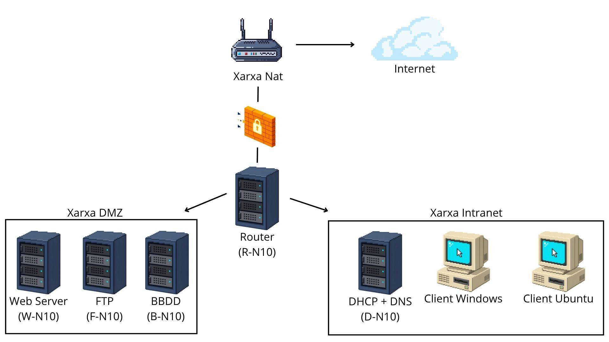

# 01 - Arquitectura de la xarxa

Fig. 1.1. Arquitectura de la nostra xarxa.

La nostra xarxa es separa en tres parts, la part d’accés a internet, la xarxa dmz i la xarxa intranet.

La zona principal, on es troba el servidor router és la zona d’accés a internet, on el router redirecciona el tràfic necessari per a als servidors i els clients. Redirecciona tot el tràfic forense d’internet cap a la xarxa DMZ, i permet que a xarxa intranet pugui accedir a la DMZ, però que la xarxa DMZ no pugui accedir a la xarxa intranet.

La **xarxa DMZ** es defineix per obtenir tots els servidors de serveis que es mostren de manera pública a la gent fora de l’empresa, la xarxa DMZ conté els següents serveis:
- **Servidor Web**: És el servidor que permet als usuaris clients fora de l’empresa poder accedir a la pàgina web de l’empresa.
- **Servidor FTP**: Permet als usuaris descarregar arxius dels nostres serveis i en el cas de que ho necessitin també pujar els seus a la pàgina web.
- **Servidor de bases de dades**: Es troba a la xarxa DMZ però només el servidor web té accés a aquest de lectura, tots els altres ports que no siguin necessaris per connectar el servidor web i aquest estan bloquejats mitjançant un firewall això es fa només per a que el servidor web pugui mostrar la informació de la base de dades i no pugui accedir cap persona.

La **xarxa intranet** és la xarxa que conté els serveis privats, és a dir, que no poden ser accedits per persones fora de l’empresa per aquest cas només hi ha:
- **Servidor DHCP + DNS**: És el indicat per a crear el pool de les ip per posar automàticament als serveis i és el que resol els noms de R-N10 i R pels altres sistemes.
- **Client Windows i Client Ubuntu**: Són els que s’utilitzaran per a posar a prova tots els serveis i verificar de que tot funciona.

