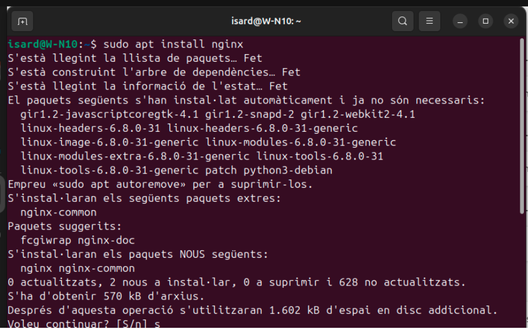
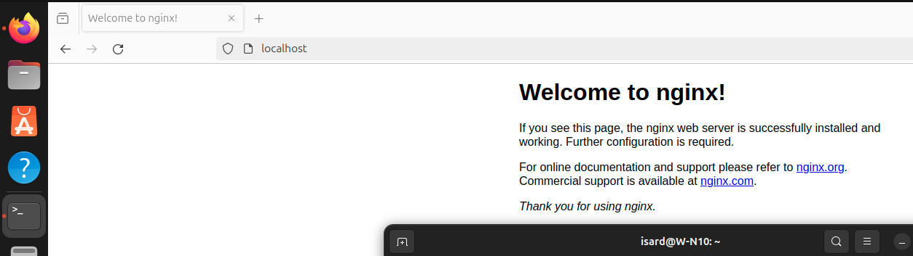

# 04 - Servidor Web

## - Introducció

El servidor Web té la tasca de instal·lar el programa NGINX i MYSQL. El programa NGINX ens permet poder crear una pàgina web, i l'utilitarem per projectar la base de dades que té el servidor de Bases de Dades.

### ¿Perquè hem escollit NGINX per al Servidor Web?

Hem escollit el programa de NGINX ja que és un programa que hem utilitzat abans i ja tenim pràctica. A part, NGINX conté una jerarquia de directoris més simple, ja que cada arxiu és una pàgina web distinta com veurem més endavant.

## Desplegament del servidor de Web

### Instal·lació i verificació de funcionament de NGINX

Primer instal·lem NGINX, llavors, per verificar de que NGINX funciona accedem a "http://localhost", amb això podrem veure de que funciona ja que apareix el text *Welcome to nginx!*.

Fig. Instal·lació de Nginx.

Fig. Verificació de que, efectivament NGINX funciona.

### Instal·lació de PHP, i preparació de les pàgines web

Per poder permetre afegir codi de PHP i crear arxius PHP per les pàgines web instal·lem PHP pel contingut necessesari amb *apt install*.

Fig. Instal·lació de PHP.

### Configuració de NGINX i creació de la pàgina web

Posem a l'arxiu "/etc/nginx/sitex-available/default" les dades per defecte i és la part que fa al NGINX utilitzar PHP.

Fig. *Default* de NGINX.

---

[← 03 - Router + DNS + DHCP](<03 - Router + DNS + DHCP.md>) -------------------------------------------------------------------------------------------------- [05 - Servidor de BBDD →](<05 - Servidor de BBDD.md>)
