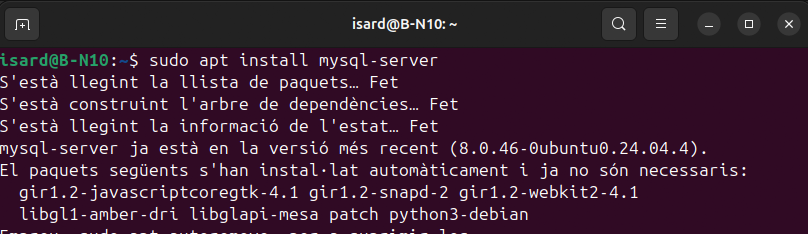
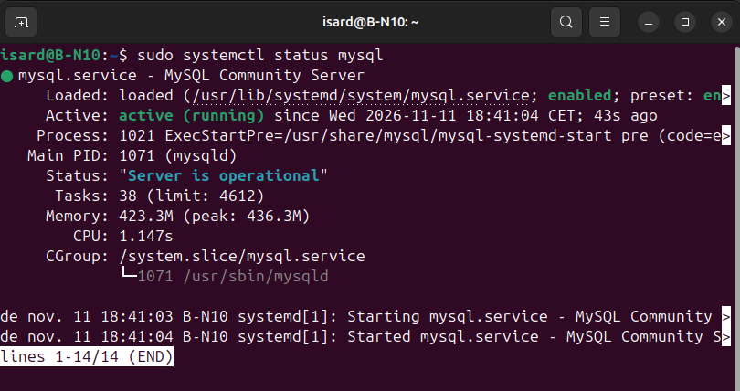

# 05 - Servidor de BBDD

## - Introducció

El servidor de BBDD és el servidor encarregat de instal·lar el programa de MYSQL per a la base de dades i mantenr aquesta. També ha de poder permetre al servidor Web poder acceir a la base de dades per a que el servidor web pugui mostrar als clients la base de dades que només volem que es mostri.

## Desplegament del servidor de BBDD

Primer instal·lem el servei MYSQL, i després per verificar que s'ha instal·lat amb èxit executem la comanda "sudo systemctl status mysql" i aixì podem veure l'estat de MYSQL i que s'ha instal·lat.

Fig. Instal·lació de MYSQL al servidor de BBDD.

Fig Observació de estat de MYSQL.

Ara creem un usuari el qual només es pot utilitzar desde la IP del servidor web, així cap altre sistema pot accedir a la base de dades, si no es des de el servidor WEB.

Fig. Creació d'usuari exclusiu per al servidor Web.

---

[← 04 - Servidor Web + FTP](<04 - Servidor Web + FTP.md>) -------------------------------------------------------------------------------------------- [06 - Client Windows i Linux →](<06 - Client Windows i Linux.md>)
