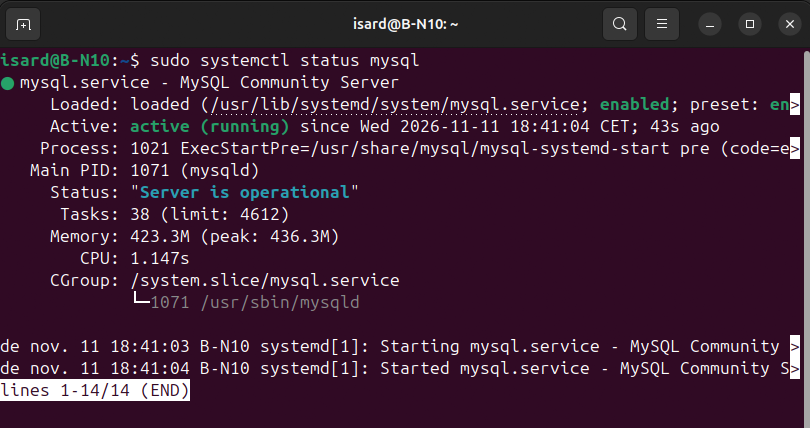
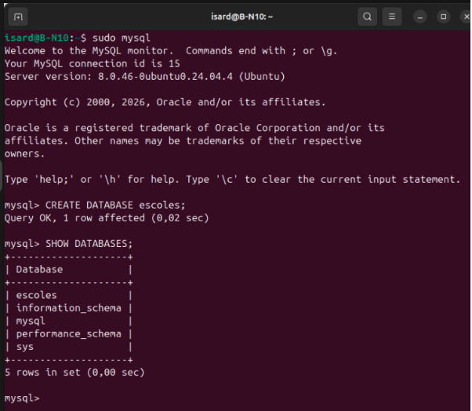
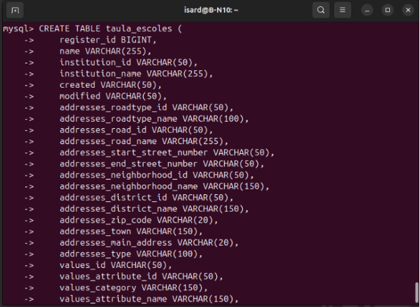
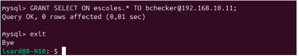
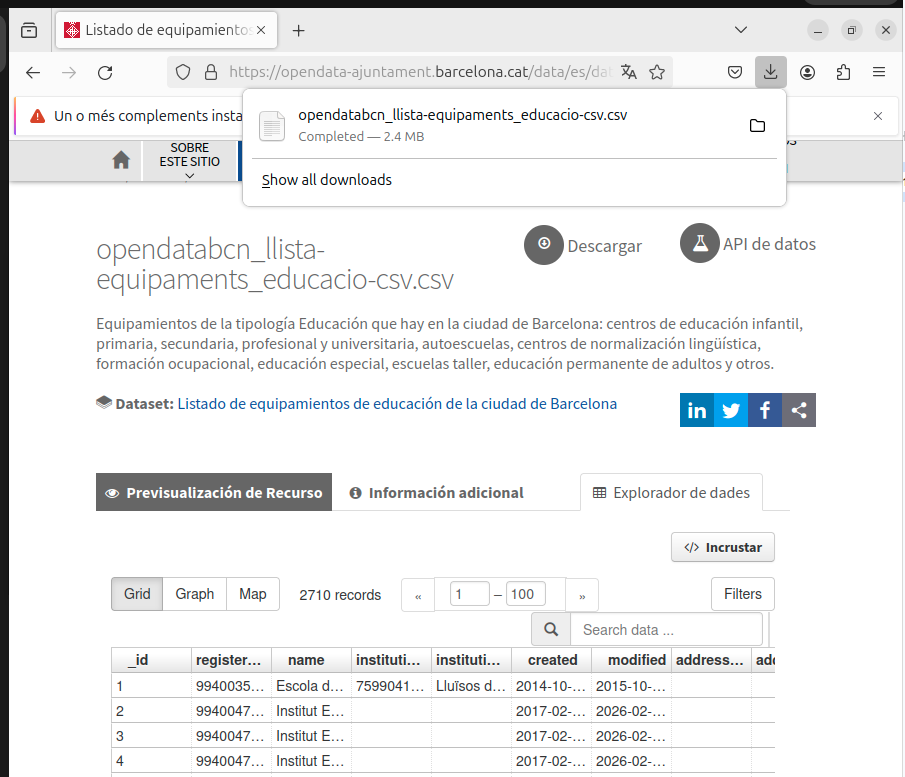
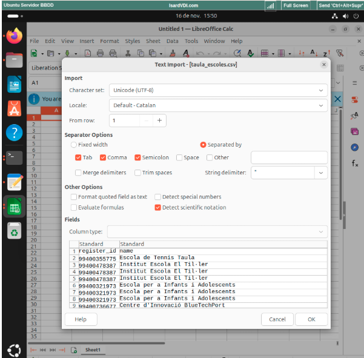
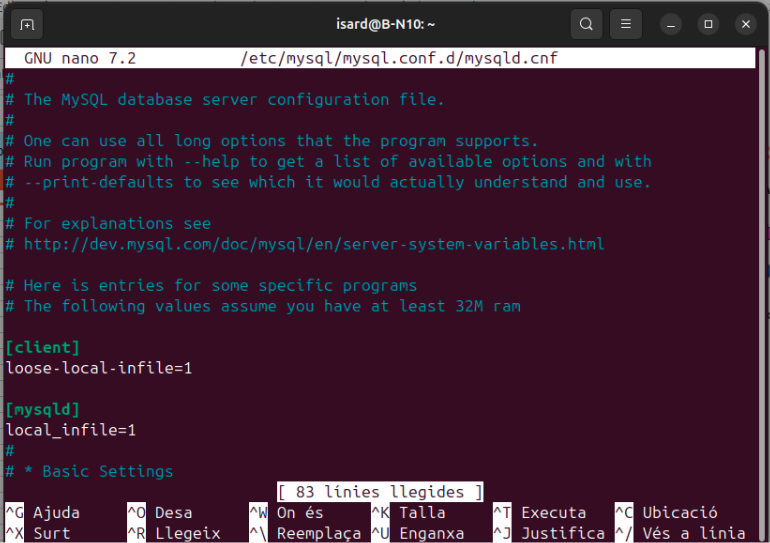
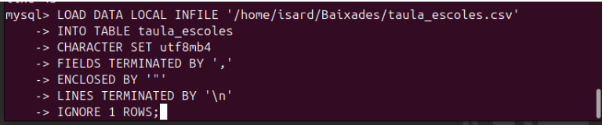
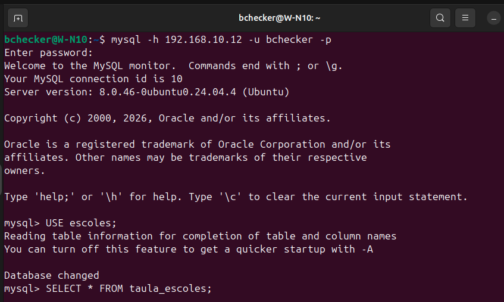
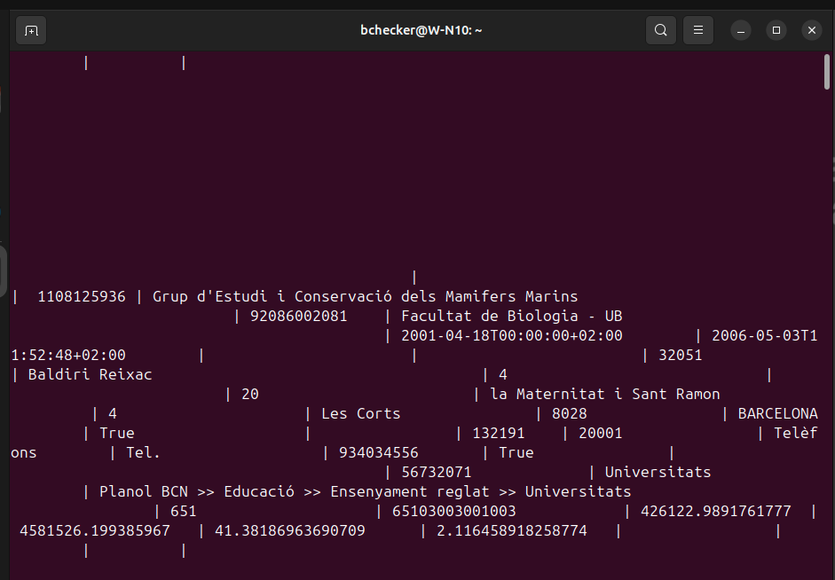

# 05 - Servidor de BBDD

## - Introducció

El servidor de BBDD és el servidor encarregat de instal·lar el programa de MYSQL per a la base de dades i mantenr aquesta. També ha de poder permetre al servidor Web poder acceir a la base de dades per a que el servidor web pugui mostrar als clients la base de dades que només volem que es mostri.

## Desplegament del servidor de BBDD

### Instal·lació de MYSQL i creació de la BBDD

Primer instal·lem el servei MYSQL, i després per verificar que s'ha instal·lat amb èxit executem la comanda "sudo systemctl status mysql" i aixì podem veure l'estat de MYSQL i que s'ha instal·lat.

Fig. Instal·lació de MYSQL al servidor de BBDD.

Fig Observació de estat de MYSQL.

Com ja hem verificat que funciona MYSQL, creem una base de dades anomenada *escoles* i una taula dins d'aquesta base de dades amb el nom de *taula_escoles*. La taula la creem amb totes les columnes que s'indiquen a l'arxiu CSV que descarregarem més endavant. La columna d'ID la declarem com *BIGINT*, ja que les IDs de les escoles son números llargs, i totes les altres dades les deixem com a *VARCHAR* ja que és text pla.

Fig. Ús de la comanda *CREATE DATABASE escoles;* per crear la base de dades.

Fig. Ús de la comanda *CREATE TABLE* per crear la taula de escoles.

### Creació de l'usuari bchecker

Ara creem un usuari el qual només es pot utilitzar desde la IP del servidor web, així cap altre sistema pot accedir a la base de dades, si no es des de el servidor WEB. També li donem permisos de SELECT, ja que només ens interessa que pugui veure la base de dades i no editar-la, aixì també evitem el fet de que si es fiquen al servidor web puguin editar o borrar la base de dades.

Fig. Creació d'usuari exclusiu per al servidor Web.

Fig. Assignació de permisos a l'usuari *bchecker*.

### Descàrrega i importació de l'arxiu CSV

Ara descarreguem l'arxiu CSV de la pàgina web que s'ha donat, i obrim dit arxiu amb el programa LibreOffice Calc per a exportar-lo en CSV i que quedi net. Això degut a que si s'intenta importar la base de dades directament del CSV de la pàgina web MYSQL ens dona errors degut als espais que hi ha.

Fig. Decàrrega de l'arxiu CSV de la base de dades demanada.

Fig. Obrint l'arxiu CSV amb OpenOffice Calc.

Ara, per poder permetre que el programa de MYSQL pugui agafar arxius locals hem d'editar larxiu */etc/mysql/mysql.conf/mysqld.cnf* i afegir les següents línies, *loose-local-infile=1* i *local_infile=1*:

Fig. Canvi a la configuració de MYSQL.

Ara per importar l'arxiu CSV a la taula que hem creat abans utilitzem la comanda *LOAD DATA LOCAL INFILE* amb els paràmetres necessaris per determinar a quina taula s'importa tot i com es separen les dades.

I per últim, per verificar que s'han afegit de manera correcta les dades a la taula, i que el servidor Web té accés a la base de dades ens ficarem desde l'usuari del servidor Web amb el paràmetre *-h* per indicar el servidor de base de dades, i el paràmetre *-u* per indicar a l'usuari amb el que anem a ficar-nos, en aquest cas, bchecker. Després d'haver-nos ficat exitòsament amb l'usuari utilitzem la comanda *SELECT* per veure totes les dades.

Fig. Accedint a MYSQL desde el servidor Web.

Fig. Ús de la comanda *SELECT* per veure les dades de la taula.

---

[← 04 - Servidor Web](<04 - Servidor Web.md>) -------------------------------------------------------------------------------------------- [06 - Client Windows i Linux →](<06 - Client Windows i Linux.md>)
